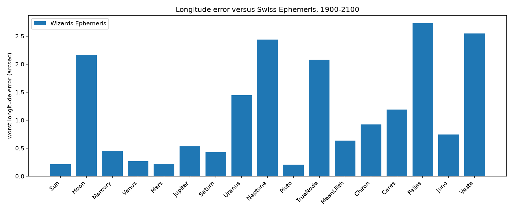

# Wizards Ephemeris


Copyright (c) 2026 Magowie Sp. z o.o.

A C++20 library for the positions, houses, and ayanamsas a natal chart needs. Coefficients live in the sources. There is no Swiss Ephemeris code in this tree, and a build of the library does not download any.

Author: Magowie Sp. z o.o.

## What it computes

- Sun, Moon, Mercury, Venus, Mars, Jupiter, Saturn, Uranus, Neptune, Pluto
- True node, mean Lilith (mean lunar apogee, ecliptic or inclined)
- Chiron, Ceres, Pallas, Juno, Vesta
- Ecliptic longitude, latitude, and longitude speed
- Right ascension and declination, for parallel and contra-parallel aspects
- Ten house systems: Placidus, Whole Sign, Koch, Equal, Regiomontanus, Campanus, Porphyry, Alcabitius, Sripati, Polich-Page, with ascendant, midheaven, and ARMC
- Tropical and sidereal zodiacs
- Ayanamsas: Lahiri, Raman, Fagan-Bradley, Krishnamurti, True Citra, Galactic center (Mula)
- True or mean sidereal nutation, and two whole-sign snap orders. See [docs/traditions.md](docs/traditions.md)
- Julian day, proleptic Gregorian calendar, and delta T

Pluto, Chiron, and the four asteroids use a built-in Chebyshev series for 1900–2100. Pass a directory of JPL `.bsp` kernels to `Ephemeris` when you have one. Outside the series, and when no kernel covers the date, the library falls back to Keplerian elements.

## Build

```
cmake -S . -B build
cmake --build build
```

The target is `eph`. C++20, no reflection, no bundled data files. In the monorepo the p2996 toolchain flags are applied when that helper is already defined, so a system compiler still configures. Pluto and the asteroids use the year series unless the configure line passes `-DEPH_MINOR_SERIES=full`.

The JavaScript package is [`wizards-ephemeris`](https://www.npmjs.com/package/wizards-ephemeris) on npm: `npm install wizards-ephemeris`. From this directory, `./scripts/build-js.sh` builds it with stock Emscripten 6.0.11 and writes a local tarball under `js/pack/`. The same build runs in Docker. Commands are in [js/README.md](js/README.md). The API is in [docs/javascript.md](docs/javascript.md).

`eph_example_tests` runs the documented examples. Build it from this directory with a normal C++ compiler, then run the binary. The stories are in [docs/examples.md](docs/examples.md).

## API

```cpp
#include "eph/eph.hpp"

eph::JulianDay jd = eph::julianDayUt(1988, 1, 30, 15.0 + 10.0 / 60.0);
eph::Ephemeris eph;
auto sun = eph.position(eph::Body::Sun, jd);
eph::Houses h = eph.houses(jd, 50.2197, 18.6742, eph::HouseSystem::Placidus);
```

The full surface is in [docs/api.md](docs/api.md). The calculation pipeline is in [docs/architecture.md](docs/architecture.md). What the library computes is listed in [docs/features.md](docs/features.md). Tradition settings are in [docs/traditions.md](docs/traditions.md).

## Accuracy

Checked by [Empheresis Comparator](https://github.com/wizards-ephemeris/ephemeris-benchmark) against Swiss Ephemeris, with solar deflection turned off on the reference so the comparison matches this model. Bounds for 1900–2100:

| Quantity | Bound |
|----------|-------|
| Sun–Saturn | 1" |
| Uranus | 2" |
| Neptune | 3" |
| Moon | 10" (speed 30"/day) |
| Pluto | 1" |
| Chiron, Ceres, Pallas, Juno, Vesta | 5" |
| True node | 10" |
| Mean Lilith longitude and latitude | 2" |
| Six ayanamsas | 1" |
| True sidereal longitude | tropical bound + 1" |
| Ascendant, MC, ARMC, vertex | 5" |
| House cusps through 2050 | 10" |



On a 1000-date scan the Sun stays within about 0.2", Uranus about 1.4", Neptune about 2.4". House cusps through 2050, including high latitudes, stay inside the arcsecond bounds above. Past 2050 the delta-T polynomials diverge by several seconds, and near the polar circle that moves a cusp by more than the geometric error.

Swiss Ephemeris is faster. It interpolates ephemeris files; this library evaluates series and does not need those files. A position call here is typically a few tenths of a millisecond. The comparator charts:

- [Position cost](docs/media/performance_position.png)
- [House cost](docs/media/performance_houses.png)

Detail and the reasons for each floor: [docs/accuracy.md](docs/accuracy.md). The default build uses a one-year series for Pluto and the asteroids. It sits about 0.3" from the 16-day table those bounds describe. `cmake -DEPH_MINOR_SERIES=full` selects that 16-day series.

## License

MIT. See `LICENSE`. Third-party attributions for the series are in `NOTICE`.
